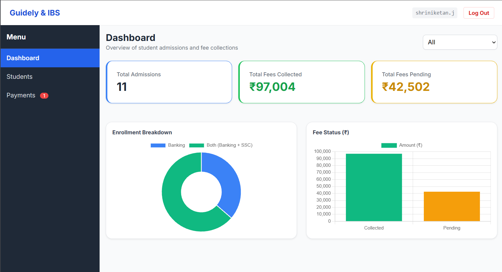
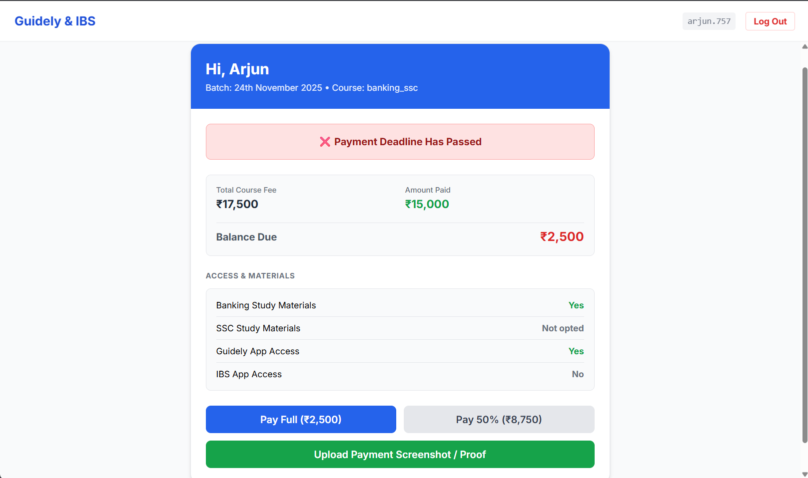

# Guidely & IBS Fee Portal

A ₹0-running-cost student fee portal for a competitive-exam institute: fixed course prices, a 15-day installment rule and direct UPI payments with no gateway fees.

> **Showcase repo.** This repository holds the product story and screenshots only. AI coding tools wrote the code under my direction, and it isn't published here.
> **Full case study:** https://shriniketan-portfolio.web.app/#/case/guidely-ibs-enrollment-portal

## The problem

At a walk-in coaching institute, two things leaked revenue:
- **Fee bargaining at admission.** With no fixed price list on screen, every admission turned into a negotiation.
- **Unpaid second installments.** Students paid half up front and many delayed the rest.

There was no budget for paid software or payment gateways.

## What I built

A two-sided web portal:
- **Student side:** the balance due, a deadline warning, and which study materials are unlocked; a UPI QR code for the exact amount due; and a payment-proof upload, capped at 2 MB per image to stay inside Firebase's free tier.
- **Admin side:** admissions and fees collected vs. pending, a searchable student ledger with standard course tiers and CSV export (so the institute keeps its Excel records), and a payment approval queue.

## The key product decision: no AI auto-approval

I first planned to have AI read each uploaded UPI screenshot and mark the fee as paid automatically. I dropped it: an edited screenshot takes seconds to make, and AI can only read the image. It can't check that the money actually reached the bank. Instead, the admin gets a one-click Approve / Reject queue and checks the bank SMS first. That takes a few seconds per payment.

## Outcome

- ₹0 infrastructure cost (Firebase free tier + Netlify) and 0% gateway commission.
- The 15-day installment rule behind it is now institute policy: 128 of 129 dues collected from Oct 2025 to Oct 2026.
- Status: working prototype. The screenshots below use **demo data only**.

## How it was built

- **My role:** problem discovery, product design, the pricing and fee rules, and testing.
- **AI tools:** Gemini (code pasted into VS Code), later Google AI Studio.
- **Stack:** HTML/JS, Tailwind CSS, Firebase, Netlify.

## Screenshots

**Admin dashboard:** admissions, fees collected vs. pending, enrollment and fee charts.

**Student view:** deadline alert, balance due, unlocked materials, and pay or upload proof.

---

Built by [M I Shriniketan Joish](https://github.com/Shri0499) · [Portfolio](https://shriniketan-portfolio.web.app) · [LinkedIn](https://www.linkedin.com/in/shriniketan-joish-634599sj)
